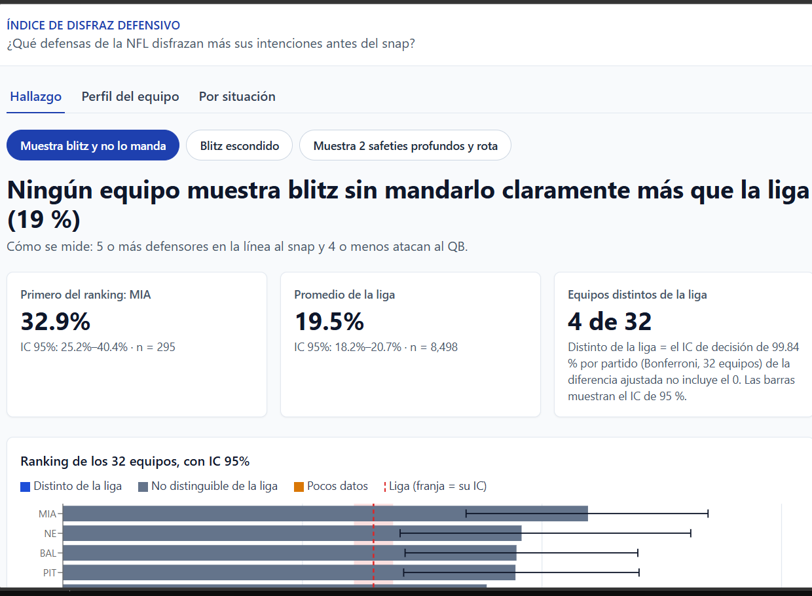

# Índice de disfraz defensivo

Construimos el Índice de disfraz defensivo, una métrica nueva presentada en un tablero que compara lo que cada defensa de la NFL muestra antes del snap con lo que realmente juega. El hallazgo más claro: cuando Miami coloca dos safeties profundos, termina jugando con uno solo atrás en 65 % de esas jugadas (entre 54 % y 77 %), casi el doble que el promedio de la liga (36 %). En las dos formas de blitz disfrazado (amenazar con blitz y no mandarlo, o esconderlo), ningún equipo destaca claramente por encima de la liga: con 7 u 8 partidos por equipo, la mayoría no se distingue, y eso también es un resultado. Lo usaría un coordinador ofensivo al preparar el partido contra un rival, para decidir la protección y qué lectura darle a su quarterback.



---

## Qué encontramos

Toda cifra lleva su intervalo de confianza al 95 % y el número de jugadas (n). Un equipo cuenta como **"distinto de la liga"** solo si pasa un criterio estricto, pensado para no premiar la suerte al comparar 32 equipos a la vez. El criterio se explica en [Cómo lo medimos](#cómo-lo-medimos).

### 1. Miami miente con sus safeties; Tampa Bay, Houston y Minnesota no

Antes del snap, dos safeties profundos le dicen al quarterback "cobertura con dos safeties atrás". Medimos cuántas veces esa imagen se convierte en una cobertura de un solo safety (Cover-3 o Cover-1) cuando sale el balón.

| Defensa | Con 2 safeties profundos al snap, juega con uno solo | Jugadas |
|---|---|---|
| **Miami (MIA)** | **65.0 %** [54.1–77.3] | 80 |
| Promedio de la liga | 35.6 % [32.8–38.5] | 3,293 |
| Tampa Bay (TB) | 11.6 % [8.8–14.9] | 95 |
| Houston (HOU) | 7.7 % [3.9–13.6] | 104 |
| Minnesota (MIN) | 2.5 % [0.0–6.2] | 80 |

- **Miami** es el único equipo claramente por encima de la liga. Tras ajustar por down, yardas por ganar y formación, rota 34.9 puntos más que el resto [+17.7, +48.8].
- **Qué significa para preparar el partido:** contra Miami, ver dos safeties atrás al snap no es una lectura confiable. En la mayoría de esas jugadas terminan con un solo safety profundo.
- **El otro extremo también sirve.** Contra Tampa Bay, Houston o Minnesota, la imagen de dos safeties casi siempre es honesta: lo que muestran es lo que juegan.
- **Para la transmisión:** "Cuando Miami enseña dos safeties profundos, en dos de cada tres jugadas está mintiendo."

### 2. El blitz simulado es una práctica de toda la liga, no de un equipo

| Métrica | Liga | Equipos claramente por encima | Claramente por debajo |
|---|---|---|---|
| **Muestra blitz y no lo manda**: 5 o más en la línea, 4 o menos atacan | 19.5 % [18.2–20.7], n = 8,498 | **Ninguno** | SF 5.7 %, CLE 7.7 %, NYJ 11.0 %, LV 13.9 % |
| **Blitz escondido**: 4 o menos en la línea, 5 o más atacan | 8.8 % [8.1–9.6], n = 8,498 | **Ninguno** | BUF 4.4 % |

- **Alrededor de 1 de cada 5 jugadas de pase** de la liga amenaza con blitz y no lo manda. Es un recurso común, no la firma de un equipo.
- **Miami encabeza el ranking** de "muestra blitz y no lo manda" con 32.9 % [25.2–40.4] (n = 295), pero no pasa el criterio estricto. Con 8 partidos no se puede descartar que sea suerte.
- **Que nadie destaque también es un resultado.** Con 7 u 8 partidos por equipo, el disfraz del blitz no separa a los equipos de forma confiable. El coordinador debería preparar a su línea contra el blitz simulado frente a cualquier rival, no solo frente a uno.
- **San Francisco, Cleveland, Nueva York (Jets) y Las Vegas casi nunca amenazan sin mandar.** Ojo: puede deberse a cómo alinean normalmente, y no a una decisión de no disfrazar (ver [Limitaciones](#limitaciones)).

### 3. El perfil de un rival en una línea

El tablero arma el perfil de cualquier equipo en las tres métricas. Para Miami: **"disfraza claramente más que la liga en 1 de 3 métricas"**, la rotación de safeties. Es el tipo de resumen que un coordinador lleva a la reunión del lunes.

---

## Cómo lo medimos

- **Lo que se muestra:** dónde está cada defensor en el instante del snap, según los datos de seguimiento (tracking). "En la línea" significa a 2 yardas o menos del balón en profundidad y a 8 o menos a lo ancho. "Safety profundo" significa a 10 yardas o más.
- **Lo que se juega:** las etiquetas de PFF, que dicen si cada defensor atacó al quarterback o cubrió, y qué cobertura se jugó.
- **Datos:** NFL Big Data Bowl, temporada 2021, semanas 1 a 8. Son 122 partidos y 8,498 jugadas de pase, sin conversiones de 2 puntos. La rotación de safeties usa las 3,293 jugadas con exactamente dos safeties profundos al snap, incluidos sacks y scrambles. Auditoría de los datos: [`docs/datos.md`](docs/datos.md).
- **Intervalos:** remuestreamos partidos completos (bootstrap por partido), porque las jugadas de un mismo partido se parecen entre sí.
- **Comparación con la liga:** se ajusta por down, yardas por ganar y formación ofensiva.
- **Criterio estricto de "distinto de la liga":** el intervalo al 99.84 % de la diferencia no incluye el cero. Es la corrección de Bonferroni por comparar 32 equipos. Las barras del tablero muestran el intervalo al 95 %, así que un equipo puede verse separado de la liga y aun así no pasar el criterio. Es el caso de Miami en blitz.
- **Código:** cada cifra de este README sale de la API ([`docs/cifras_readme.txt`](docs/cifras_readme.txt)). La API la calcula con [`backend/analisis.py`](backend/analisis.py) y [`backend/stats_toolkit.py`](backend/stats_toolkit.py). Pregunta y análisis declarados de antemano: [`PLAN.md`](PLAN.md).

## Limitaciones

- **No es causal.** Medimos cuánto disfraza cada defensa, no si el disfraz funciona ni si engaña al quarterback.
- **Los umbrales son supuestos** (2 yd, 8 yd y 10 yd). Todavía no probamos si el ranking cambia con otros valores.
- **SF, CLE y NYJ** pueden salir bajos en "muestra blitz y no lo manda" por cuántos jugadores alinean normalmente en la línea, no por una decisión de disfrazar.
- **"Lo que se juega" viene de etiquetas de PFF**, que son anotación humana.
- **Cada equipo jugó 7 u 8 partidos**, así que los intervalos por equipo pueden quedar algo estrechos.
- **Solo hay pases de 2021, semanas 1 a 8**, y el tracking trae unos 5 frames antes del snap: no se puede estudiar el movimiento previo.
- **La vista por situación** (down y yardas por ganar) es exploratoria: compara 7 situaciones sin corrección.

**Siguientes pasos:** probar otros umbrales, revisar si el ranking se sostiene entre las semanas 1-4 y 5-8, y separar la alineación habitual de cada defensa del disfraz.

---

## Cómo correrlo

Requiere el entorno del evento (Python 3.12 en `.venv`, Node 22). Desde la raíz, en dos terminales:

```powershell
.venv\Scripts\uvicorn backend.main:app --port 8000      # API (tarda ~30 s en calcular al arrancar)
cd dashboard; npm ci; npm run dev                        # tablero en http://127.0.0.1:5173
```

Endpoints: `/health`, `/api/meta`, `/api/resumen`, `/api/comparacion`, `/api/serie`. Contrato en [`docs/api.md`](docs/api.md).

**Stack:** Python 3.12 · FastAPI · pandas/numpy · React + Vite + TS + Tailwind + Recharts

**Equipo:** Hugo (análisis y API) y Fernando (tablero y README). Hackathon NFL Big Data Bowl, UNAM.
